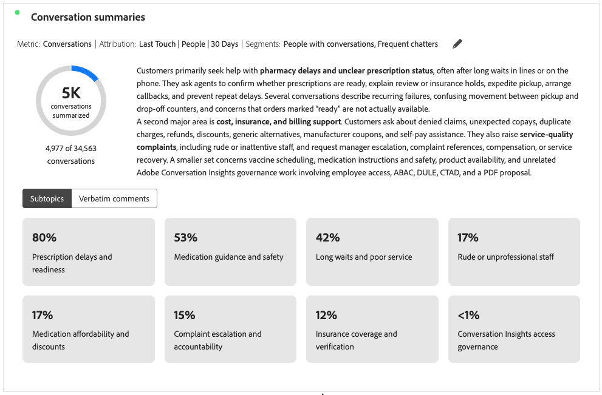

# 대화 요약 {#conversation-summaries}

>[!CONTEXTUALHELP]
>id="workspace_conversationsummaries_button"
>title="대화 요약"
>abstract="필터링된 대화 그룹을 요약하는 시각화를 만듭니다."

>[!CONTEXTUALHELP]
>id="workspace_conversationsummaries_panel"
>title="대화 요약"
>abstract="필터링된 대화 그룹을 요약합니다. 요약 길이를 제어합니다. 추출된 신호의 정확성을 검증하려면 고객의 대표 구문을 확인합니다. 전체 대화 재생을 열려면 견적을 선택하십시오."

{{release-limited-testing}}

 **[!UICONTROL 대화 요약]** 시각화를 사용하면 필터링된 대화 그룹을 요약할 수 있습니다.

시각화는 선택한 지표(예: 대화)의 요약을 보여주며 하위 주제를 포함하도록 시각화를 구성한 경우 하위 주제 또는 축어 주석을 표시합니다.

## 만들기 및 구성 {#conversation-summaries-create-configure}

>[!CONTEXTUALHELP]
>id="workspace_conversationsummaries_usenondefaultattributionmodel"
>title="비기본 기여도 모델 사용"
>abstract="이 지표에 대해 기본값이 아닌 속성 모델을 활성화합니다."

>[!CONTEXTUALHELP]
>id="workspace_conversationsummaries_usenondefaultattributionmodel_disabled"
>title="비기본 기여도 모델 사용"
>abstract="기본값이 아닌 속성 모델은 이 지표에 사용할 수 없습니다."

**[!UICONTROL 대화 요약]** 시각화를 만들고 구성하려면:

1.  **[!UICONTROL 대화 요약]** 시각화를 추가합니다. [패널 내에 시각화 추가](/help/analysis-workspace/visualizations/freeform-analysis-visualizations.md#add-visualizations-to-a-panel)를 참조하십시오.

1. **[!UICONTROL 대화 요약]** 시각화 구성:

   1. **[!UICONTROL 지표]**&#x200B;을(를) 선택하십시오. 예: **[!UICONTROL 대화]**.
   1. 선택적으로 지표에서 기본값이 아닌 [속성](/help/analysis-workspace/attribution/models.md) 모델을 사용하려면 **[!UICONTROL 기본값이 아닌 속성 모델 사용]**&#x200B;을 선택하고 **[!UICONTROL 모델]**, **[!UICONTROL 컨테이너]** 및 **[!UICONTROL 전환 확인 기간]**&#x200B;을 선택합니다.
   1. 원할 경우 시각화에 세그먼트를 적용할 수 있습니다. **[!UICONTROL 세그먼트]** 드롭다운 메뉴에서 세그먼트를 선택합니다.

1. **[!UICONTROL 빌드]**&#x200B;를 선택하여 시각화를 빌드합니다. 구성 값을 기본값으로 재설정하려면 **[!UICONTROL 재설정]**&#x200B;을 선택하십시오. 구성을 취소하려면 **[!UICONTROL 취소]**&#x200B;를 선택하십시오.

**[!UICONTROL 대화 요약]** 시각화를 다시 구성하려면 **[!UICONTROL 지표: _지표_]**&#x200B;또는&#x200B;**[!UICONTROL 지표:_지표_]** 옆에 있는 을 선택합니다. | **[!UICONTROL 세그먼트: _세그먼트_]**.

## 사용

시각화를 사용하려면 다음을 수행하십시오.

>[!BEGINTABS]

>[!TAB 하위 항목]

>[!TAB 축어 설명]

>[!ENDTABS]

* [포함된 하위 주제](#settings)가 있는 경우 **[!UICONTROL 하위 주제]**&#x200B;를 선택하여 하위 주제를 표시하거나 **[!UICONTROL 축어 설명]**&#x200B;을 선택하여 축어 설명을 표시합니다.
* **[!UICONTROL 버바텀 댓글]**&#x200B;을(를) 선택한 경우 을(를) 선택하여 버바텀 댓글이 속한 특정 대화에 대한 새 [**[!UICONTROL 대화 검토]**](./conversation-review.md) 시각화를 엽니다.

## 설정

다음 특정 [시각화 설정](/help/analysis-workspace/visualizations/freeform-analysis-visualizations.md#settings)을 사용할 수 있습니다.

| 설정 | 설명 |
|---|---|
| **[!UICONTROL 요약 길이]** | 요약 길이를 지정합니다. **[!UICONTROL 짧게]** 또는 **[!UICONTROL 길게]** 중에서 선택할 수 있습니다. |
| **[!UICONTROL 하위 항목 포함]** | 시각화에 하위 주제를 표시하려면 **[!UICONTROL 하위 주제 포함]**&#x200B;을 선택하십시오. **[!UICONTROL 최대 하위 항목 수]**&#x200B;를 사용하여 표시할 최대 하위 항목 수를 구성하십시오. |
