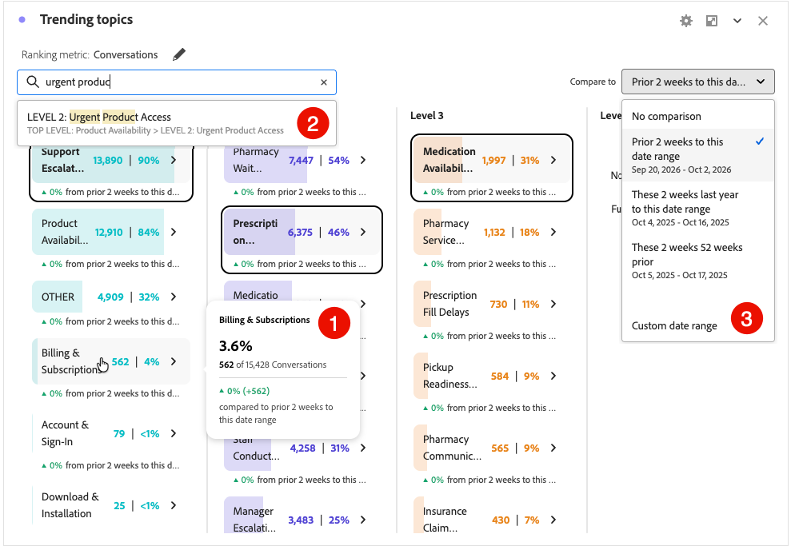

# 트렌딩 토픽 {#trending-topics}

>[!CONTEXTUALHELP]
>id="workspace_trendingtopics_button"
>title="트렌딩 토픽"
>abstract="대화에서 주요 테마를 식별할 수 있도록 발생 횟수 및 백분율과 함께 트렌드 토픽에 대한 계층적 드릴다운 기반 분류를 보여 주는 시각화를 만듭니다."

>[!CONTEXTUALHELP]
>id="workspace_trendingtopics_panel"
>title="트렌딩 토픽"
>abstract="선택된 등급 지표를 기반으로 트렌딩 토픽을 분석합니다. 최대 5개 수준 깊이로 드릴 다운할 토픽을 선택합니다. 특정 토픽을 검색하고 토픽을 다른 날짜 범위와 비교합니다."

{{release-limited-testing}}

 **[!UICONTROL 트렌드 주제]** 시각화를 사용하면 대화 통찰력의 일부로 트렌드 주제를 탐색하고 분석할 수 있습니다.

특정 주제를 검색하고 각 수준에서 각 주제의 수 및 백분율을 다른 데이터 범위와 비교할 수 있습니다.

## 만들기 및 구성 {#trendimg-topics-create-and-configure}

>[!CONTEXTUALHELP]
>id="workspace_trendingtopics_usenondefaultattributionmodel"
>title="비기본 기여도 모델 사용"
>abstract="이 지표에 기본값이 아닌 속성 모델을 사용합니다."

>[!CONTEXTUALHELP]
>id="workspace_trendingtopics_usenondefaultattributionmodel_disabled"
>title="비기본 기여도 모델 사용"
>abstract="기본값이 아닌 속성 모델은 이 지표에 사용할 수 없습니다."

**[!UICONTROL 트렌드 항목]** 시각화를 만들고 구성하려면:

1.  **[!UICONTROL 트렌드 주제]** 시각화를 추가합니다. [패널 내에 시각화 추가](/help/analysis-workspace/visualizations/freeform-analysis-visualizations.md#add-visualizations-to-a-panel)를 참조하십시오.

1. **[!UICONTROL 트렌드 항목]** 시각화 구성:

   1. **[!UICONTROL 순위 지표]**&#x200B;을(를) 선택하십시오. 예: **[!UICONTROL 대화]**.
   1. 선택적으로 지표에서 기본값이 아닌 [속성](/help/analysis-workspace/attribution/models.md) 모델을 사용하려면 **[!UICONTROL 기본값이 아닌 속성 모델 사용]**&#x200B;을 선택하고 **[!UICONTROL 모델]**, **[!UICONTROL 컨테이너]** 및 **[!UICONTROL 전환 확인 기간]**&#x200B;을 선택합니다.
1. **[!UICONTROL 빌드]**&#x200B;를 선택하여 시각화를 빌드합니다. 구성 값을 기본값으로 재설정하려면 **[!UICONTROL 재설정]**&#x200B;을 선택하십시오.

트렌드 항목 시각화를 다시 구성하려면 **[!UICONTROL 순위 지표: _순위 지표_ 옆에 있는 을 선택합니다. | 하위 항목 수준: _x_]**.

## 사용

시각화를 사용하려면 다음을 수행하십시오.

* 자세한 내용이 포함된 팝업을 보려면 주제 위로 마우스를 가져갑니다. ➊

* 하위 수준의 주제에 대한 트렌드 하위 주제를 보려면 특정 수준의 주제를 선택합니다. 하위 수준에서 사용할 수 있는 항목이 없는 경우  **[!UICONTROL _주제 > 하위 주제_ > ...]**&#x200B;에 대한 하위 주제를 찾을 수 없습니다.

* 항목을 빠르게 검색하려면  **[!UICONTROL _항목 검색_]**&#x200B;을 사용하십시오. ➋

* 항목을 다른 날짜 범위와 비교하려면 **[!UICONTROL 비교 대상]**&#x200B;에서 날짜 범위를 선택하십시오. ➌

  사용자 지정 날짜 범위를 사용하려면 다음을 수행하십시오.

  * 드롭다운 메뉴에서 **[!UICONTROL 사용자 지정 날짜 범위]**&#x200B;를 선택하고 **[!UICONTROL 새 날짜 범위]** 대화 상자에서 사용자 지정 날짜 범위를 정의하고 저장합니다.
  * 해당 사용자 지정 날짜 범위를 선택합니다.

* 현재 선택한 항목에 대한 선 그래프를 표시하려면 **[!UICONTROL 트렌드 항목]** 시각화에 [선](/help/analysis-workspace/visualizations/line.md) 시각화를 놓습니다. **[!UICONTROL Line]** 시각화는 **[!UICONTROL 트렌드 주제]** 시각화에 자동으로 연결되고 선택한 주제에 대한 줄을 표시합니다.

  

## 설정

다음 특정 [시각화 설정](/help/analysis-workspace/visualizations/freeform-analysis-visualizations.md#settings)을 사용할 수 있습니다.

| 설정 | 설명 |
|---|---|
| **[!UICONTROL 실제 값 표시]** | 항목에 대한 실제 값을 표시합니다. |
| **[!UICONTROL 표시 비율]** | 항목에 대한 백분율을 표시합니다. |
