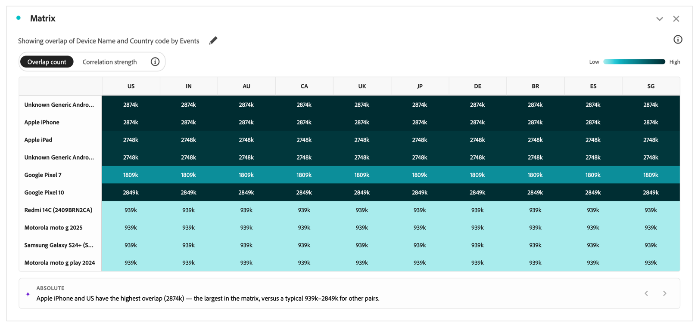

# 매트릭스 시각화 구성

매트릭스 시각화는 두 차원의 차원 항목이 서로 겹치거나 상호 관련되는 방식을 보여 주는 값 그리드입니다. 각 셀에는 행의 차원 항목과 열의 차원 항목의 교차 지점이 표시됩니다.

## 매트릭스 개요

다음을 포함하여 매트릭스 시각화에 대한 자세한 내용은 [매트릭스 개요](/help/analysis-workspace/visualizations/matrix/matrix.md)를 참조하세요.

* 주요 기능

* 잠재적 인사이트

* 매트릭스, 자유 형식 테이블, 벤 및 분산형 시각화의 차이점

## 매트릭스 시각화 작성

1. 프로젝트에 빈 패널을 추가하고 왼쪽 레일에서 [!UICONTROL **시각화**] 아이콘을 선택한 다음 [!UICONTROL **매트릭스**] 시각화를 패널로 드래그합니다. <!-- FOLLOW-UP: add the Matrix icon before the name when it's available in help/assets/icons. -->

   또는

   [시각화 개요](/help/analysis-workspace/visualizations/freeform-analysis-visualizations.md)의 [패널에 시각화 추가](/help/analysis-workspace/visualizations/freeform-analysis-visualizations.md#add-visualizations-to-a-panel) 섹션에 설명된 방법으로 매트릭스 시각화를 추가하십시오.

   <!-- add screenshot of the Matrix configuration fields -->

1. 다음 정보를 지정하여 매트릭스 시각화를 구성합니다.

   | 필드 | 함수 |
   |---------|----------|
   | [!UICONTROL **행 차원**] | 항목이 매트릭스에서 행으로 표시되는 차원입니다. |
   | [!UICONTROL **열 차원**] | 항목이 매트릭스에 열로 표시되는 차원입니다. 
행 차원과 열 차원 모두에 대해 동일한 차원을 선택하는 경우 매트릭스 시각화가 차원 항목을 서로 비교합니다. 예를 들어 두 차원이 모두 _장치 유형_&#x200B;인 경우 각 셀은 _휴대폰_ 및 _태블릿_&#x200B;과 같은 두 장치 유형 간에 겹치거나 상관 관계를 표시합니다. 대각선 위 값과 아래 값은 서로 대칭됩니다.
 |
   | [!UICONTROL **지표**] | 각 셀의 행 차원 항목과 열 차원 항목의 조합에 대해 표시되는 지표입니다. |
   | [!UICONTROL **컨테이너**] | 행 차원 항목과 열 차원 항목 간의 겹침 범위를 결정하는 컨테이너입니다. (컨테이너 이름이 아래 표시된 기본 이름과 다른 경우, 데이터 보기에서 사용자 정의된 것입니다.)<ul><li>**사용자:**(기본값) 행 차원 항목과 열 차원 항목이 동일한 사용자에 대해 발생할 때 세션 수에 관계없이 겹칩니다.</li><li>**세션:** 행 차원 항목과 열 차원 항목이 동일한 세션에서 겹치는 경우 겹칩니다.</li><li>**이벤트:** 행 차원 항목과 열 차원 항목이 동일한 이벤트에서 발생할 때 겹칩니다.</li></ul><!-- SME CHECK: confirm how each container defines overlap. --> |

1. (선택 사항) 다음 설정을 변경합니다.

   | 필드 | 함수 |
   |---------|----------|
   | [!UICONTROL **행 제한**] | 매트릭스 시각화에 표시되는 최대 행 수입니다. 기본값은 10입니다. <!-- SME CHECK: Which items are shown (top items by the metric?)? Does the limit also apply to columns? What's the maximum? --> |
   | [!UICONTROL **중복 팔레트**] | 매트릭스에 [겹침 개수](#view-overlap-count-or-correlation-strength)가 표시되는 셀의 색 눈금이 표시됩니다. |
   | [!UICONTROL **상관 관계 팔레트**] | 매트릭스가 [상관 관계 강도](#view-overlap-count-or-correlation-strength)를 표시할 때 셀의 색상 비율입니다. 음수 및 양수 상관 관계는 서로 다른 색상을 사용합니다. |
   | [!UICONTROL **상관 관계 세부 기간**] | **[!UICONTROL 일]**&#x200B;과 같이 [상관 관계 강도](#view-overlap-count-or-correlation-strength)를 계산하는 데 사용되는 시간 세부기간입니다. 이 값은 패널 날짜 범위를 기반으로 자동으로 설정됩니다. 변경할 수 없습니다. 
패널 날짜 범위에 따라 다음 세부 기간이 선택됩니다.
<ul><li>[!UICONTROL **시간**]: 7일 이내의 날짜 범위에 대해 선택됨</li><li>[!UICONTROL **일**]: 7일 이상, 최대 3개월 범위의 날짜에 대해 선택됨</li><li>[!UICONTROL **주**]: 3개월 이상, 최대 1년 날짜 범위에 대해 선택됨</li><li>[!UICONTROL **개월**]: 1년 이상의 날짜 범위에 대해 선택됨</li></ul><!-- SME CHECK: The granularities and date range thresholds in this list are a best guess. Confirm which granularities are used for which date ranges. --> |
   | [!UICONTROL **대각선 셀 값**] | 매트릭스 시각화가 차원 항목과 만나는 셀을 표시하는 방법입니다. 이 설정은 행 차원과 열 차원이 동일한 경우에만 사용할 수 있습니다.<ul><li>**[!UICONTROL 표시]:**&#x200B;은(는) 값을 표시합니다.</li><li>**[!UICONTROL 대시]:**&#x200B;이(가) 값 대신 대시를 표시합니다.</li><li>**[!UICONTROL Blank]:** 셀을 비워 둡니다.</li></ul> |

1. [!UICONTROL **빌드**]&#x200B;를 선택합니다.

   <!-- add screenshot -->

1. 다음 섹션을 계속합니다. [중복 개수 또는 상관 관계 강도를 봅니다](#view-overlap-count-or-correlation-strength).

## 중복 카운트 또는 상관 관계 강도 보기

<!-- markdownlint-disable MD034 -->

>[!CONTEXTUALHELP]
>id="cja_matrix_overlap_correlation"
>title="중복 카운트와 상관 관계 강도 비교"
>abstract="
**Overlap count**&#x200B;은 행 차원 항목과 열 차원 항목이 겹치는 선택한 지표의 값입니다.

**상관 관계 강도**&#x200B;는 두 차원 항목에 대한 지표가 시간이 지남에 따라 함께 이동하는 정도를 -1에서 +1까지 선형적으로 상관합니다. +1의 값은 함께 오르락 내리락 하는 것을 의미하고, 0은 관계가 없음을 의미하며, -1은 반대 방향으로 움직이는 것을 의미한다. 상관 강도는 중첩과 별도로 계산되므로, 중첩이 적은 차원 항목은 여전히 강한 상관을 가질 수 있다.
"

<!-- markdownlint-enable MD034 -->

매트릭스 시각화를 전환하여 겹침 카운트 또는 상관 관계 강도를 표시할 수 있습니다. 오버랩 수는 기본적으로 표시됩니다.

1. Analysis Workspace에서 매트릭스 시각화를 열거나 [새 시각화를 만들기](#build-a-matrix-visualization)합니다.

1. 매트릭스 시각화의 왼쪽 상단 모서리에서 다음 옵션 중 하나를 선택합니다.

   * [!UICONTROL **겹침 개수**]: 각 행 차원 항목과 각 열 차원 항목이 겹치는 정도를 표시합니다. 각 셀에는 두 차원 항목이 모두 발생하는 사람, 세션 또는 이벤트(컨테이너에 따라 다름)에 대해 선택한 지표의 값이 표시됩니다.

   * [!UICONTROL **상관 관계 강도**]: 각 행 차원 항목 및 각 열 차원 항목에 대해 선택한 지표가 패널 날짜 범위 동안 -1에서 +1까지의 선형 상관 관계로 얼마나 가깝게 이동하는지 보여 줍니다. 값이 +1이면 두 차원 항목이 항상 함께 상승하고 하락함을 의미하고, 0이면 관계가 없음을 의미하며, -1이면 항상 반대 방향으로 이동함을 의미합니다. 상관 강도는 중첩과 별도로 계산되므로, 중첩이 적은 차원 항목은 여전히 강한 상관을 가질 수 있다. 상관 관계는 [!UICONTROL **상관 관계 세부 기간**] 설정에 표시된 시간 세부 기간으로 계산됩니다. <!-- SME CHECK: Confirm that the linear correlation is Pearson. -->

   매트릭스 시각화의 오른쪽 상단 모서리에 있는 범례는 현재 보기에 대한 색상 스케일을 표시합니다. 겹침 카운트에는 낮음에서 높음, 상관 강도에는 음수(-1)에서 양(+1)입니다.

## 인사이트 보기

<!-- FOLLOW-UP: Draft based on a prototype screenshot. Add a screenshot of the insight card. -->

매트릭스 시각화 하단에 있는 insight 카드는 매트릭스 데이터의 주목할 만한 패턴에 대해 설명합니다.

<!-- SME CHECK: How are insights generated (AI)? What does the label on the card (such as ABSOLUTE) mean, and what other labels are there? Do the insights differ between the Overlap count and Correlation strength views? Are they updated when you change the settings or the panel date range? Can you hide the card? Are any permissions, entitlements, or AI settings required? -->

인사이트를 보려면 다음 작업을 수행하십시오.

1. 매트릭스 시각화에서 시각화 하단에 있는 insight 카드를 봅니다.

1. insight 카드의 화살표를 사용하여 사용 가능한 통찰력을 페이징합니다.

## 매트릭스 설정 편집

매트릭스 시각화를 작성한 후 차원, 지표 또는 컨테이너와 같은 설정을 변경할 수 있습니다.

매트릭스 설정을 편집하려면:

1. 매트릭스 시각화에서 시각화 상단에 있는 자막 옆에 있는 을 선택합니다. 부제에는 지표 및 차원과 같은 현재 설정이 요약되어 있습니다.

1. [매트릭스 시각화 만들기](#build-a-matrix-visualization)에 설명된 설정을 변경합니다.

1. [!UICONTROL **빌드**]&#x200B;를 선택합니다.

<!-- SME CHECK: Confirm that the Edit icon reopens the build settings. Does the Matrix keep the Overlap count or Correlation strength view after you rebuild it? -->

## 트렌드 데이터 보기

[선 시각화](/help/analysis-workspace/visualizations/line.md)에서 셀에 대한 트렌드 데이터를 볼 수 있습니다. 라인 시각화는 패널 날짜 범위 동안 선택한 지표가 변경되는 방식을 보여 줍니다. 표시되는 선은 행렬에 [겹침 개수 또는 상관 관계 강도](#view-overlap-count-or-correlation-strength)가 표시되는지 여부에 따라 다릅니다.

트렌드 데이터를 보려면 다음을 수행합니다.

1. 매트릭스 시각화에서 트렌드 데이터를 보려는 셀을 마우스 오른쪽 버튼으로 클릭합니다.

1. [!UICONTROL **트렌드**]&#x200B;를 선택합니다.

   라인 시각화가 매트릭스 시각화 위의 패널에 추가됩니다.

   * [!UICONTROL **중복 개수**]: 한 줄에 행 차원 항목과 열 차원 항목으로 모두 필터링된 선택한 지표가 표시됩니다.

   * [!UICONTROL **상관 관계 강도**]: 행 차원 항목과 열 차원 항목에 대해 각각 하나씩, 두 줄에 선택한 지표가 표시됩니다. 라인을 비교하여 두 차원 항목이 얼마나 밀접하게 함께 트렌드되는지 확인합니다.

   <!-- SME CHECK: Does the overlap count filter use the Matrix container? Is the time granularity the panel default or the Correlation granularity? Can you select multiple cells? Is the option available for diagonal cells? -->

## 벤 시각화에서 겹침 보기

[벤 시각화](/help/analysis-workspace/visualizations/venn.md)에서 셀에 대한 행 차원 항목과 열 차원 항목 간의 겹침을 볼 수 있습니다.

행렬 시각화 또는 벤 시각화를 사용할 시기에 대한 자세한 내용은 [행렬 개요](/help/analysis-workspace/visualizations/matrix/matrix.md)에서 [행렬, 자유 형식 테이블, 벤 또는 산포 시각화 중 선택](/help/analysis-workspace/visualizations/matrix/matrix.md#choose-between-matrix-freeform-table-venn-or-scatter-visualizations)을 참조하십시오.

벤 시각화에서 겹침을 보려면 다음을 수행합니다.

1. Matrix 시각화에서 겹쳐 표시할 셀을 마우스 오른쪽 단추로 클릭합니다.

1. [!UICONTROL **Venn에 표시**]&#x200B;를 선택합니다.

   벤 시각화가 패널에 추가됩니다. 한 원은 행 차원 항목을 나타내고 다른 원은 열 차원 항목을 나타냅니다. 벤 시각화는 매트릭스 시각화와 동일한 지표를 사용합니다. <!-- SME CHECK: Where is the Venn visualization added? Are segments created for each dimension item, and do they use the Matrix container? Is the option available for diagonal cells and in the Correlation strength view? -->

## 분류 적용

다른 차원으로 셀에 대한 데이터를 분류하여 셀 값에 기여하는 차원 항목을 확인할 수 있습니다.

분류를 적용하려면:

1. Matrix 시각화에서 분류를 적용할 셀을 마우스 오른쪽 단추로 클릭합니다.

1. [!UICONTROL **분류**]&#x200B;를 선택합니다.

1. 분류에 사용할 차원을 선택합니다.

   분류 차원에 대한 상위 차원 항목은 새 자유 형식 테이블에 표시됩니다. <!-- SME CHECK: Where is the table added? Does the breakdown use the Matrix metric and container? Can you select multiple cells? Is the option available for diagonal cells and in the Correlation strength view? -->

